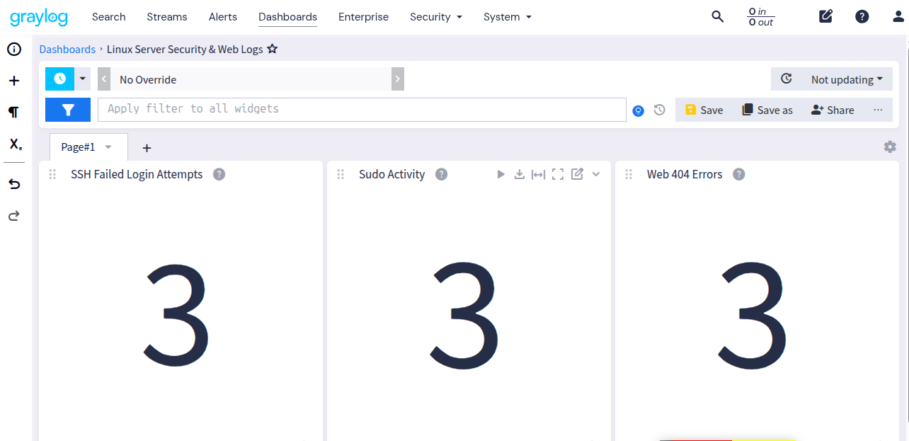

```markdown
# Linux Server Log Dashboards for Graylog

A lightweight Graylog dashboard for Linux server security and web log monitoring.

This project provides a reusable dashboard for monitoring common Linux server events, including SSH failed login attempts, sudo activity, and HTTP 404 errors.

## Features

- SSH failed login monitoring
- Sudo activity monitoring
- HTTP 404 error monitoring
- Message-count visualizations
- Simple Graylog dashboard
- Graylog content pack
- Example Linux log messages
- Suitable for Linux server monitoring and security operations

## Dashboard

The dashboard contains three widgets:

- **SSH Failed Login Attempts**
- **Sudo Activity**
- **Web 404 Errors**



### SSH Failed Login Attempts

Searches for:

```text
"Failed password"
```

Useful for identifying repeated SSH authentication failures.

### Sudo Activity

Searches for:

```text
sudo
```

Useful for monitoring privileged command activity.

### Web 404 Errors

Searches for:

```text
"404"
```

Useful for identifying missing pages and common web-server errors.

## Requirements

- Graylog 7.1.9 or newer
- A Graylog input capable of receiving Linux or web-server logs
- Logs indexed and searchable by Graylog

## Installation

1. Download `content_pack.json`.
2. Open Graylog.
3. Go to **System → Content Packs**.
4. Import the content pack.
5. Select the **Linux Server Security & Web Logs** dashboard.
6. Open the dashboard and adjust the time range as required.

## Sample Logs

The `sample-logs.txt` file contains example messages that can be used to test the dashboard.

These examples are synthetic test data and do not represent real users or production systems.

## Use Cases

This dashboard can be used as a starting point for:

- Linux server monitoring
- Linux security monitoring
- SSH authentication monitoring
- Privileged command monitoring
- Web server log monitoring
- HTTP error monitoring
- Server log analysis
- Security operations

## Linux Server Management

For Linux server administration, monitoring, security, troubleshooting, and performance management, see [iServerSupport Linux Server Management](https://iserversupport.com/linux-server-management/).

## Repository Structure

```text
linux-log-dashboards/
├── content_pack.json
├── README.md
├── sample-logs.txt
├── screenshot-dashboard.png
└── LICENSE
```

## License

This project is released under the MIT License.
```
